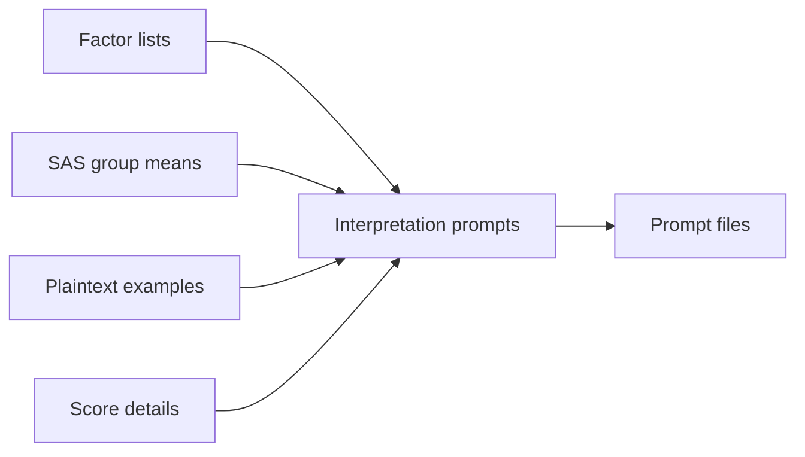

# Requirements

### Goal
Adapt `interpretation_prompts.py` to the ENADE phase without changing its prompt assembly or example-selection logic.

### Expected behavior
- Default to `year_chapter` groups and describe the ENADE course-report corpus and its `c4`, `c5`, and `c6` section labels accurately; discuss year/chapter patterns rather than geographic strata.
- Work from any current directory using phase-relative defaults and relative overrides; retain existing CLI options and absolute-path overrides.
- Produce one `interpretation/input/f<n>_<pole>.txt` per factor-pole file, retaining the existing system/user prompts, means, loadings, excerpts, and loading-word sections.
- Do not change upstream data, selection quotas, excerpt extraction, or call an LLM.

# Technical Design

### Existing integration
`factor_lists.py` supplies `factors/f<n>_<pole>.txt`; SAS supplies `means_year_chapter_f<n>.tsv`; `examples_txt.py` supplies numbered examples with `Text ID` headers; `score_details.py` supplies the per-document factor/pole words. All eight current poles have examples whose first ten IDs match the score-details report.

### Changes
- In `cl_st2_ph1_fernanda/interpretation_prompts.py`, follow `examples_txt.py`: derive `PHASE_DIR` and the default project from `__file__`, default the group to `year_chapter`, and resolve every relative input/output override and the default SAS directory against that phase directory. Preserve absolute paths, `--project`, and `--group`.
- Update `group_description`, `phase_description`, and group-specific user wording to identify ENADE report sections and year/chapter groups. Preserve single-pole interpretation, equal emphasis on loadings and examples, and the existing handling of positive and negative means. Describe loading words as document-level evidence, not necessarily words present in the truncated excerpt.
- Preserve natural ordering, the first 10 examples and first 30 file lines by default, full-file ID detection, score-detail lookup, output names, and existing warning/fallback behavior. Existing matching output files are overwritten; stale files are not cleaned. The excerpt includes example metadata, and the listed words may also appear there.
- Expand section 19 of `cl_st2_ph1_fernanda/cl_st2_ph1_fernanda_pipeline.md` with prerequisites, defaults, overrides, and limitations. Note that the first ten examples may all come from the top-ranked group, so they are not a representative sample; chapter-level loading words need not appear within the excerpt. Preserve the upstream corpus audit caveats.

### File Structure
- Modify `cl_st2_ph1_fernanda/interpretation_prompts.py` and `cl_st2_ph1_fernanda/cl_st2_ph1_fernanda_pipeline.md`.
- Add `cl_st2_ph1_fernanda/tests/test_interpretation_prompts.py`.

### Flow

# Testing

### Validation
- Use temporary fixtures and subprocess tests modeled on `tests/test_examples_txt.py` to check both poles, multiple factors, natural example ordering, ID lookup, accents, and exact section contents.
- Verify 10-example/30-line defaults, custom limits, full-file ID detection, and document-level word lookup without filtering to excerpt text.
- Check phase-directory and external working directories, relative and absolute overrides, `--project`/`--group`, missing required inputs, missing means/example folders, missing IDs, and empty or missing word lists against existing behavior.
- Run a smoke test with the available project inputs and an isolated temporary output directory; cross-check eight prompts and four year/chapter means files without altering project artifacts.

# Delivery Steps

### ✓ Step 1: Adapt phase defaults and project context
The prompt generator resolves ENADE inputs consistently and describes the correct corpus.

- Update `interpretation_prompts.py` to use the script’s phase directory, default project, and `year_chapter` group.
- Resolve relative CLI paths against the phase directory while preserving absolute overrides and existing arguments.
- Adjust system and user wording for ENADE report sections, year/chapter patterns, and document-level loading words.
- Add focused tests for defaults, overrides, working directories, and corpus wording.

### ✓ Step 2: Verify unchanged prompt assembly and document usage
Each factor pole produces a prompt using the existing selection, excerpt, and lookup behavior.

- Add fixture-based regression coverage for ordering, both polarities, score-detail parsing, excerpt limits, missing inputs, and warning fallbacks.
- Smoke-test the available inputs into a temporary directory and cross-check the eight expected outputs.
- Expand pipeline section 19 with commands, inputs, overwrite behavior, sampling limitations, and corpus audit caveats.