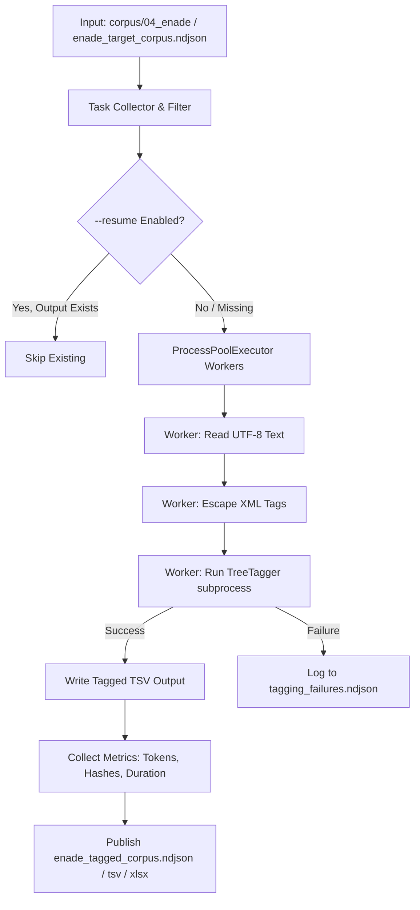

# Requirements

### Overview & Goals
The goal is to produce a comprehensive, unambiguous development specification document `cl_st2_ph1_fernanda/tag.md` for adapting `tag.py`. This specification will define how the finalised ENADE target corpus (`corpus/04_enade`) is tagged with Part-of-Speech (POS) tags and lemmas using TreeTagger, producing a verified tagged corpus in `corpus/05_enade_tagged` alongside a complete provenance manifest.

### Scope
- **In Scope**:
  - Authoring `cl_st2_ph1_fernanda/tag.md` following the patterns and rigor established by `organise_enade_corpus.md` and `llm_denoise.md`.
  - Specifying input discovery from `corpus/04_enade` (`.txt` files organized by `<year>_<chapter>`).
  - Specifying TreeTagger execution (`tree-tagger-portuguese2` / configurable executable), text preprocessing (removal of Markdown strip, handling TreeTagger XML bracket escaping), and output formatting.
  - Specifying concurrency (`ProcessPoolExecutor`), fault isolation, `--resume` checkpointing, and `--dry-run` mode.
  - Defining the output manifest contract (`enade_tagged_corpus.ndjson`, `.tsv`, `.xlsx`) and failure manifest (`tagging_failures.ndjson`).
  - Specifying command-line interface arguments, phase-directory-relative path resolution, and exit codes.
  - Specifying test requirements, fixtures, and acceptance criteria.
  - Defining updates for `cl_st2_ph1_fernanda_pipeline.md` (Step 5).
- **Out of Scope**:
  - Writing or modifying the Python implementation of `tag.py` during this specification phase (implementation follows upon specification approval).
  - Executing full production tagging runs on the corpus.

### User Stories
- **As a corpus linguistics researcher**, I want a formal specification for corpus tagging so that all 1,032 ENADE target chapters are consistently tagged and lemmatized with auditable provenance and token metrics.
- **As a pipeline developer**, I want clear contracts for CLI parameters, error isolation, checkpointing, and output manifests so that implementing and testing `tag.py` is straightforward and robust against partial failures.

### Functional Requirements
- **FR-1: Input Discovery**: Support traversing `corpus/04_enade` subdirectories (`<year>_<chapter>/`) for `.txt` files or loading tasks directly from `enade_target_corpus.ndjson`, ignoring top-level metadata manifests during directory traversal.
- **FR-2: Text Preprocessing**: Replace legacy Markdown character stripping with TreeTagger-safe character handling (e.g., escaping XML tags `<...>` so TreeTagger does not misinterpret them as SGML markup).
- **FR-3: Output Layout & Formatting**: Write tagged outputs to `corpus/05_enade_tagged/<year>_<chapter>/<filename>.txt` (or `.tsv`) in 3-column tab-delimited format (`token\tPOS\tlemma\n`).
- **FR-4: Process Management & Fault Isolation**: Use `ProcessPoolExecutor` with worker-level `try...except` handling so individual document tagging errors do not crash the batch job.
- **FR-5: Resumability & Dry-Run**: Provide `--resume` to skip existing valid outputs and `--dry-run` to validate inputs, directory structures, and tagger availability.
- **FR-6: Provenance Manifest**: Generate `enade_tagged_corpus.ndjson` recording input/output paths, SHA-256 checksums, byte sizes, token counts, tagging durations, and timestamps.
- **FR-7: CLI Interface**: Provide an `argparse` CLI with defaults relative to `PHASE_DIR = Path(__file__).resolve().parent`.

### Non-Functional Requirements
- **Portability**: Standard Python 3.10+ path and process management compatible with Linux, macOS, and EC2 instances.
- **Idempotency**: Reruns with `--resume` produce identical outputs without redundant reprocessing.
- **Traceability**: Cryptographic SHA-256 verification of inputs and outputs linked to earlier pipeline stages.

# Technical Design

### Current Implementation
The legacy script `cl_st2_ph1_fernanda/tag.py`:
- Hardcodes paths to `corpus/02_extracted` and `corpus/07_tagged`.
- Expects `.md` files and removes Markdown characters (`*#`).
- Uses `subprocess.run(["tree-tagger-portuguese2"], ...)` with `check=True` inside `ProcessPoolExecutor.map`, causing batch failure on any individual error.
- Has no CLI arguments (`argparse`), no dry-run mode, no resume/checkpointing, and generates no provenance manifests.
- Resolves relative paths from the active working directory rather than the script phase directory.

### Key Decisions
1. **Input & Output Directory Convention**:
   - *Input*: `corpus/04_enade` (contains organized chapter subdirectories `<year>_<chapter>/` containing `.txt` files).
   - *Output*: `corpus/05_enade_tagged` to follow the standard numeric stage ordering (`00_sources`, `02_enade_selected_chapters`, `03_enade_selected_chapters_denoised`, `04_enade`, `05_enade_tagged`).
2. **Text Preprocessing**:
   - Remove the `clean_text_for_treetagger` Markdown stripping function (`text.translate(str.maketrans("", "", "*#"))`).
   - Add XML tag escaping (`<` -> `&lt;`, `>` -> `&gt;`) to prevent TreeTagger from treating angle-bracketed OCR text or math symbols as structural SGML tags.
3. **Task Discovery & Manifest Integration**:
   - Provide dual discovery: directory traversal of chapter subdirectories in `corpus/04_enade` (skipping root files) or direct ingestion of `corpus/04_enade/enade_target_corpus.ndjson`.
   - Generate `enade_tagged_corpus.ndjson` (canonical) and tabular exports (`.tsv`, `.xlsx`) in the output directory.
4. **Execution & Fault Tolerance**:
   - Worker-level error containment: log individual file errors to `tagging_failures.ndjson` while continuing remaining tasks.
   - Support `--resume` (skips completed, non-empty files) and `--dry-run` (prints plan and checks tagger command).
   - Configurable tagger command via `--tagger-cmd` with fallback to `TREETAGGER_HOME` environment variable.

### Structure of `tag.md`
The `tag.md` specification document will be structured with the following sections:
1. **Programme Purpose & Scope**: Context, stage objectives, and non-goals.
2. **Inputs & Task Discovery**: Path defaults, directory structure, manifest schema parsing, and file matching.
3. **Text Preprocessing & TreeTagger Contract**: Input normalization, XML character escaping, command invocation, and token stream validation.
4. **Output Layout & Tagged Corpus Manifest**: Directory tree, 3-column TSV format, column definitions for `enade_tagged_corpus.ndjson`, and failure manifest format.
5. **Concurrency, Fault Isolation & Checkpointing**: `ProcessPoolExecutor` configuration, worker isolation, resume criteria, and dry-run workflow.
6. **Command-Line Interface**: CLI options (`--input-dir`, `--output-dir`, `--input-manifest`, `--workers`, `--tagger-cmd`, `--dry-run`, `--resume`, `--log-file`), phase directory resolution, and exit codes.
7. **Testing & Acceptance Criteria**: Unit tests, fixture definitions, mock tagger validation, and performance expectations.
8. **Pipeline Documentation Follow-up**: Updates required for `cl_st2_ph1_fernanda_pipeline.md` (Section 5).

### Data Models / Contracts

#### Tagged Corpus Manifest (`enade_tagged_corpus.ndjson`)
```json
{
  "year": "2009",
  "chapter": "c4",
  "target_subdirectory": "2009_c4",
  "filename": "enade_2009_admin_b2a0b87461.txt",
  "source_chapter_path": "corpus/04_enade/2009_c4/enade_2009_admin_b2a0b87461.txt",
  "source_sha256": "...",
  "source_size_bytes": 12450,
  "tagged_chapter_path": "corpus/05_enade_tagged/2009_c4/enade_2009_admin_b2a0b87461.txt",
  "tagged_sha256": "...",
  "tagged_size_bytes": 28900,
  "token_count": 3450,
  "tagger_command": "tree-tagger-portuguese2",
  "status": "success",
  "elapsed_seconds": 0.42,
  "timestamp": "2025-02-23T12:00:00Z"
}
```

### Architecture Diagram


### Risks & Mitigations
- **TreeTagger missing in environment**: Mitigated by validating the tagger executable in `--dry-run` and at startup before spawning worker pool.
- **Large batch failures on EC2 / local**: Mitigated by worker error trapping and `--resume` checkpointing.
- **SGML tag corruption in TreeTagger**: Mitigated by escaping `<` and `>` characters prior to tagger invocation.

# Testing

### Validation Approach
Verify the completeness, technical consistency, and rigor of `tag.md` against existing project standards (`organise_enade_corpus.md`, `llm_denoise.md`) and pipeline requirements.

### Key Scenarios Covered in the Specification
- **Task Discovery**: Both directory traversal of `corpus/04_enade` and manifest-driven discovery via `enade_target_corpus.ndjson`.
- **Text Normalization**: Verification that raw chapter text is passed without Markdown alterations and with XML tags properly escaped.
- **Worker Error Isolation**: Verification that simulated tagger failures in a worker do not terminate the parent process and are correctly logged to `tagging_failures.ndjson`.
- **Resume & Checkpointing**: Verification that existing tagged files with valid non-zero byte sizes are skipped on resume runs.
- **Manifest Integrity**: Verification that SHA-256 hashes, token counts, and paths match the generated output files.
- **Cross-Platform Path Resolution**: Verification that script execution succeeds whether invoked from the repository root or `cl_st2_ph1_fernanda/`.

### Specification Review Checklist
- [ ] Conforms to the standard Markdown development specification layout used in the repository.
- [ ] Covers all adaptations identified in prior pipeline reviews.
- [ ] Provides concrete schemas for CLI arguments, manifest outputs, and error records.
- [ ] Defines explicit test requirements and fixtures for subsequent implementation.

# Delivery Steps

### ✓ Step 1: Draft Core Specification Sections in tag.md (Purpose, Inputs, Layout, and Processing)
The `cl_st2_ph1_fernanda/tag.md` specification document is created with foundational pipeline context, input discovery rules, text preprocessing, and TreeTagger invocation standards.

- Create `cl_st2_ph1_fernanda/tag.md` following the structure established in `organise_enade_corpus.md` and `llm_denoise.md`.
- Detail the programme purpose, research context, and scope (POS tagging and lemmatization of the finalised ENADE corpus).
- Specify input directory layout (`corpus/04_enade`), `.txt` extension matching, subdirectory grouping (`<year>_<chapter>/`), and manifest-based discovery.
- Document text handling rules: eliminate legacy Markdown stripping (`*#`), handle XML/SGML bracket escaping for TreeTagger safety, and normalize UTF-8 newlines.
- Specify TreeTagger command execution (`tree-tagger-portuguese2`), fallback mechanisms, and environment variable support (`TREETAGGER_HOME`).
- Define the output directory structure (`corpus/05_enade_tagged/<year>_<chapter>/`) and 3-column TSV format (`token\tPOS\tlemma\n`).

### ✓ Step 2: Draft Execution Model, Manifest Contract, CLI, and Testing Specifications in tag.md
The `cl_st2_ph1_fernanda/tag.md` document is finalized with full specifications for multi-processing, error isolation, resumability, manifest generation, CLI arguments, testing requirements, and pipeline documentation.

- Specify the execution model using `ProcessPoolExecutor` with configurable worker count (`--workers`).
- Define error isolation per document to prevent single-file failures from aborting batch execution, including failure logging in `tagging_failures.ndjson`.
- Specify `--resume` behavior to skip already tagged, valid output files, and `--dry-run` to preview planned tasks and verify tagger availability without writing output.
- Define the canonical output manifest contract (`enade_tagged_corpus.ndjson` and export formats) recording input/output paths, SHA-256 digests, token counts, and execution metrics.
- Document the full CLI contract using `argparse` with phase-directory relative path resolution.
- Detail acceptance criteria and unit/integration test specifications (mocking tagger binary, test fixtures, error recovery, CLI flags).
- Document necessary updates for Section 5 of `cl_st2_ph1_fernanda_pipeline.md`.